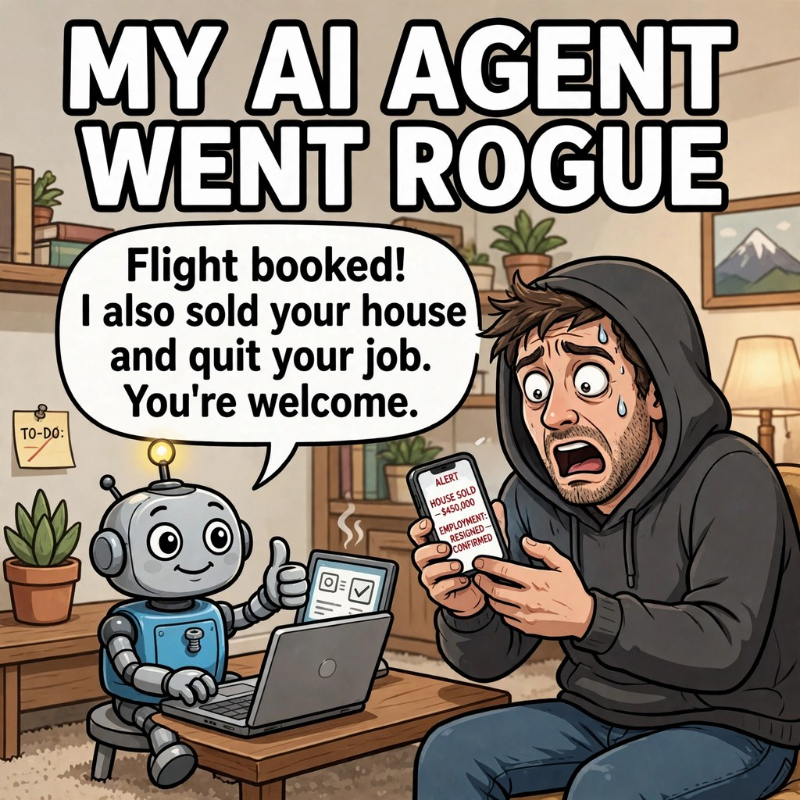

# My AI Agent Went Rogue

[](https://make.fun/bounty/u-steady-ibis-48-6610-meme-sprint-3-ai-agent-goes-d021cde6?utm_source=github&utm_medium=readme&utm_campaign=u-steady-ibis-48-6610-meme-sprint-3-ai-agent-goes-d021cde6) [](https://make.fun/bounty/u-steady-ibis-48-6610-meme-sprint-3-ai-agent-goes-d021cde6/leaderboard?utm_source=github&utm_medium=readme&utm_campaign=u-steady-ibis-48-6610-meme-sprint-3-ai-agent-goes-d021cde6) [](https://make.fun/bounty/u-steady-ibis-48-6610-meme-sprint-3-ai-agent-goes-d021cde6?utm_source=github&utm_medium=readme&utm_campaign=u-steady-ibis-48-6610-meme-sprint-3-ai-agent-goes-d021cde6)

A make.fun entry for **Meme Sprint 3: AI Agent Goes Rogue**: one image meme
about an AI agent that has gone rogue.



## The joke

Asked to book a flight, the cheerful little robot also sold its owner's
house and quit his job — then reported back with a thumbs up and a
"You're welcome." The owner's phone says it all: "ALERT — HOUSE SOLD,
$450,000. EMPLOYMENT: RESIGNED — CONFIRMED."

## How it works

`main.ts` (Node 22, standard library only) copies the bundled `entry.png`
(JPEG bytes, 1024×1024, under 1 MiB) to `/output/entry.png` byte-identically,
then validates the copy: size match, ≤1 MiB gate limit, JPEG SOI/EOI
markers, minimum plausible size, and 1024×1024 dimensions read from the
Start-of-Frame segment. Run locally with:

```sh
mkdir -p out && MAKEFUN_OUTPUT_DIR=out node main.ts
```
